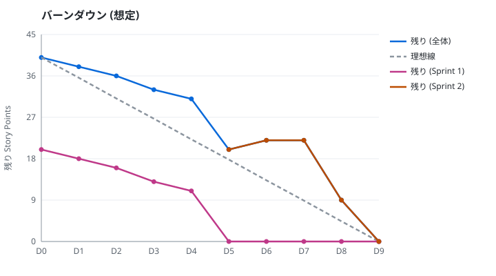
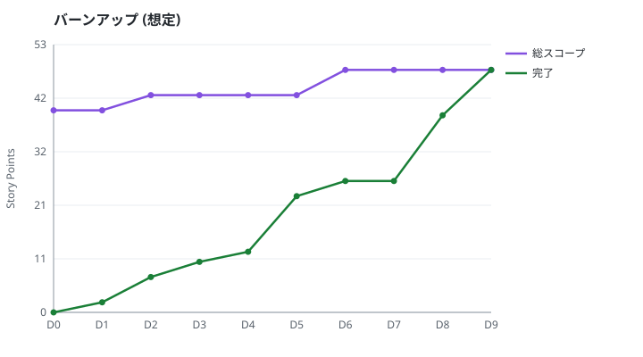
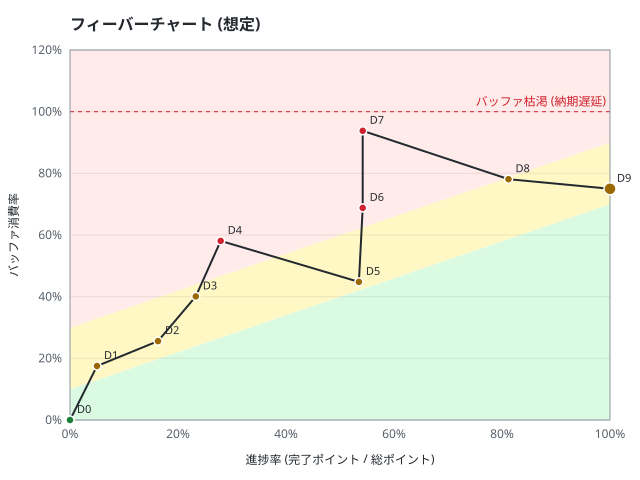
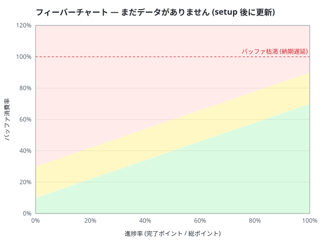

# ProjectManagementSandbox

GitHub Issues + Projects の **Insights** で、バーンダウン / バーンアップ / フィーバーチャートを試すためのモックプロジェクトです。

架空の「社内ポータル v1.0 リリース」(2 スプリント × 5 営業日、Story Points 計 40pt → スコープ追加で 48pt) を、
GitHub Actions が **毎営業日 1 日ずつ進めます**。Insights の履歴グラフは実時間でしか溜まらないため、
約 2 週間で 3 種類のチャートがひと通り描けます。

| 想定されるバーンダウン | 想定されるバーンアップ | 想定されるフィーバーチャート |
|---|---|---|
|  |  |  |

> 上の画像は `python scripts/pm.py preview` が GitHub に触れずに出力した「この通りに進めばこうなる」図です。

## シナリオ

| Day | 出来事 | チャートに出ること |
|---:|---|---|
| 0 | Sprint 1 開始 (S1: 20pt / S2: 20pt) | |
| 2 | 【追加】監査ログ出力 +3pt | バーンアップの総スコープ線が上がる |
| 4 | SSO 連携が終わらず Sprint 1 を持ち越し | Sprint 1 のバーンダウンが 0 にならない / フィーバー 🔴 |
| 5 | Sprint 2 開始、SSO・監査ログ完了 | 急降下、フィーバー 🟡 に回復 |
| 6–7 | 【追加】モバイル表示崩れ +5pt、進捗停滞 | バーンダウンが一時的に上がる / バッファ消費 94% 🔴 |
| 8–9 | 一気に完了 | 残り 0、バッファ 75% で納期内に着地 🟡 |

日々の進行は [mock/backlog.json](mock/backlog.json) の `added_day` / `start_day` / `done_day` で決まります。
計画値 (クリティカルチェーン 6 営業日 + プロジェクトバッファ 4 営業日) とゾーン境界は [mock/config.json](mock/config.json) にあります。

## 作られるもの

**Project フィールド**

| フィールド | 型 | 用途 |
|---|---|---|
| Status | 既定 (Todo / In Progress / Done) | 進捗 |
| Story Points | Number | バーンダウン / バーンアップの Y 軸 |
| Sprint | Iteration (1 週間 × 2) | スプリント単位の絞り込み |
| Fever Value | Number | フィーバー指標の値 (%) |
| Fever Metric | Single select (Progress % / Buffer %) | フィーバーの系列 |
| Fever Zone | Single select (Green / Yellow / Red) | 現在のゾーン |

**Issue**: 作業 Issue 13 件 (`mock` ラベル、うち途中追加 2 件は `scope-creep`) と、
フィーバー用トラッカー Issue 2 件 (`fever` ラベル)。トラッカーの本文には日次の推移表が自動で書き込まれます。

## セットアップ

前提: [gh CLI](https://cli.github.com/) と Python 3.10+。

1. gh に Projects 権限を追加する

   ```bash
   gh auth refresh -s project
   ```

2. (任意) GitHub に触れずに想定チャートを確認する

   ```bash
   python scripts/pm.py preview
   ```

3. Project・フィールド・Issue を作成する (Day 0 の状態になります)

   ```bash
   python scripts/pm.py setup
   ```

   - Organization の Project にしたい場合は `--owner <org名>`、開始日を指定する場合は `--start-date 2026-11-30`。
   - `mock/state.json` (Project の ID など) と `docs/` が生成されます。

4. 生成物をコミットして push する

   ```bash
   git add mock/state.json docs && git commit -m "Set up mock project" && git push
   ```

5. Actions 用のトークンを登録する
   Projects (v2) は `GITHUB_TOKEN` では操作できないため、`repo` と `project` スコープの classic PAT を作り、
   リポジトリの **Settings → Secrets and variables → Actions** に `PROJECT_TOKEN` として登録します。
   以降は平日 09:00 JST に [daily-simulation.yml](.github/workflows/daily-simulation.yml) が 1 日分進めます。

## Insights でのチャート設定

Project 右上の **Insights** → **New chart** で作成し、右上の **Configure** で以下を設定します。
X 軸を **Time** にすると履歴グラフになります。期間は右上で「2 weeks」などに切り替えます。

### 1. バーンダウン (スプリント)

| 項目 | 設定 |
|---|---|
| Filter | `sprint:"Sprint 1" -status:Done -label:fever` |
| Layout | Line |
| X-axis | Time |
| Y-axis | Sum of **Story Points** |

残りポイントが右下がりの線になります。Sprint 2 用にフィルタを変えたチャートも作ると、持ち越し (SSO) と途中追加の影響が比べられます。
リリース全体のバーンダウンは `sprint:` を外した `-status:Done -label:fever` です。

> Insights は理想線を引けません。理想線つきの比較は `docs/preview-burndown.svg` を参照してください。

### 2. バーンアップ (リリース)

| 項目 | 設定 |
|---|---|
| Filter | `-label:fever` |
| Layout | Stacked area |
| X-axis | Time |
| Group by | Status |
| Y-axis | Sum of **Story Points** |

Done の面積が完了量、積み上げの頂点が総スコープです。Day 2 と Day 6 に頂点が上がる (スコープ増加) のが読み取れます。
Insights 既定の「Burn up」チャートは件数ベースなので、ポイントで見たい場合はこちらを使います。

### 3. フィーバーチャート

Insights には散布図がないため、2 つの見せ方を用意しています。

**(a) Insights: 進捗率とバッファ消費率の推移**

| 項目 | 設定 |
|---|---|
| Filter | `label:fever` |
| Layout | Line |
| X-axis | Time |
| Group by | Fever Metric |
| Y-axis | Sum of **Fever Value** |

バッファ消費率 (Buffer %) の線が進捗率 (Progress %) の線より上にある期間は、遅れがバッファを食っている状態です。
現在のゾーンは、X 軸を **Fever Zone**、Layout を Bar にした current chart で表示できます。

**(b) 本来のフィーバーチャート (散布図)**

[docs/fever-chart.svg](docs/fever-chart.svg) を Actions が毎日更新します (横軸: 進捗率、縦軸: バッファ消費率、背景の緑 / 黄 / 赤がゾーン)。
同じ表はトラッカー Issue の本文にも書き込まれます。



#### 計算式

```
進捗率        p = 完了 Story Points / 総 Story Points
バッファ消費率 b = max(0, 経過営業日 - p × クリティカルチェーン日数) / プロジェクトバッファ日数
ゾーン: b が「黄線」以上なら Yellow、「赤線」以上なら Red
        黄線 = 10% → 70%、赤線 = 30% → 90% (進捗 0% → 100% で直線補間)
```

## コマンド

| コマンド | 内容 |
|---|---|
| `python scripts/pm.py preview` | GitHub を使わず想定チャートを `docs/preview-*.svg` に出力 |
| `python scripts/pm.py setup` | Project・フィールド・ラベル・Issue を作成 |
| `python scripts/pm.py tick [--day N]` | Issue / Status を Day N (既定: 今日) の状態にする。何度実行しても同じ結果 |
| `python scripts/pm.py fever [--day N]` | Project の実データからフィーバー指標を計算して更新 |
| `python scripts/pm.py status` | 現在の Day と各 Issue の状態を表示 |

`--day` で日を飛ばすと Issue の状態はすぐ変わりますが、Insights の履歴は「実際に変更された時刻」で記録されます。
グラフの形を見たいときは、毎営業日 1 回ずつ進めてください。

## 実プロジェクトへの流用

- `fever` は実データ (Project の Status と Story Points) から計算するので、`mock/config.json` の `plan` と
  `mock/state.json` を実 Project に合わせ、ワークフローの `tick` ステップを外せばそのまま使えます。
- バーンダウン / バーンアップは、実 Project に **Story Points (Number)** と **Sprint (Iteration)** を作れば上記の Insights 設定がそのまま使えます。

## 片付け

Project は Project の Settings → **Delete project**、Issue は `mock` / `fever` ラベルで絞り込んで削除またはクローズしてください。
その後 `mock/state.json` と `docs/fever-*` を消せば `setup` から作り直せます。
